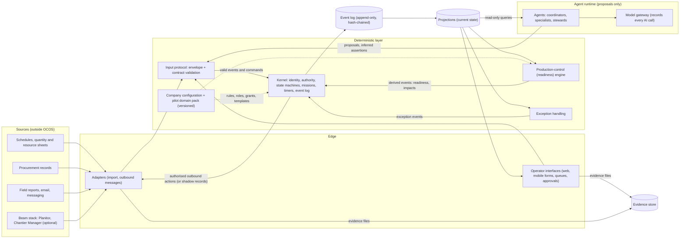

# OCOS v1.0.0 — Architecture

*Status: draft for owner review, 2026-10-15. Scope: v1.0.0 only (the idea's §13 initial scope). The long-term direction appears only as extension points (section 16).*
*Companion documents: [IDEA.md](IDEA.md) (source of record), [core_logic.md](core_logic.md) (plain-language overview), [v1.0.0_spec.md](v1.0.0_spec.md) (testable requirements, `SPEC-nnn`), [QUESTIONS.md](QUESTIONS.md) (owner decisions, `Q-nn`).*

**How to read the status of each statement**

- **IDEA §n** — taken directly from the owner's idea.
- **PROPOSAL** — a design choice made by the authors of this document to make the idea buildable. The owner may change it; nothing in the idea forbids it.
- **TO-CONFIRM (Q-nn)** — cannot be decided without the owner; the recommendation is in QUESTIONS.md. Nothing that depends on it is treated as decided.

---

## 1. What v1.0.0 must do

One workflow on one real project: **work-package readiness and constraint resolution** (IDEA §13). The nine minimum capabilities of §13 are the whole functional scope; everything in this document exists to serve them, and the spec ties each requirement back to them (SPEC-001).

The pilot contractor, project and work type are not chosen yet: `TO-CONFIRM (Q-01)`. The architecture below does not depend on that answer, except for the content of the pilot domain pack (section 4.7).

## 2. Principles carried from the idea

| # | Principle | Source |
|---|---|---|
| P1 | One authoritative operational state, rebuilt from an append-only event log, replayable without an LLM. | IDEA §5 |
| P2 | AI interprets, investigates and proposes; deterministic code authorises, enforces constraints, changes state and records execution. | IDEA §5 |
| P3 | The kernel is small, stable, testable and independent of any AI model. | IDEA §5 |
| P4 | Reported fact, AI inference, verified observation and authorised decision are always distinguishable. | IDEA §4 |
| P5 | Unknown stays unknown; information is requested only when a decision or operation needs it. | IDEA §4 |
| P6 | Company behaviour comes from versioned configuration, never from forking the kernel; mandatory safety, security and legal constraints cannot be disabled by ordinary configuration. | IDEA §10 |
| P7 | The system never silently expands its own authority. | IDEA §9 |
| P8 | External systems stay authoritative for the records they own unless an explicit agreement says otherwise. | IDEA §11 |
| P9 | Shadow mode first; bounded autonomy later, one action type at a time. | IDEA §13 |

## 3. Components and data flows

**Boundary rules (PROPOSAL, derived from IDEA §5):**

- Everything that changes operational state enters through the **input protocol** and becomes an event in the **event log** written by the **kernel**. There is no other write path — not for adapters, not for the user interface, not for agents.
- Agents **read** projections and **write** only proposals and inferred assertions. They never write state directly and never call adapters directly; outbound actions are executed by the kernel through adapters after authorisation.
- The readiness engine and exception handling are deterministic modules: given the same events and the same configuration version, they produce the same derived events. On replay their outputs are recomputed and checked against the log.
- Configuration is read by the deterministic layer; it is itself changed only through governed events (section 7.4).

## 4. Components

### 4.1 Input protocol and event envelope

**Job:** turn every input — a spreadsheet row, a form, a message, an agent's proposal, a timer — into a validated event with provenance (IDEA §4).

- **Universal envelope** (fields in SPEC-050): event id, type, contract version, when it happened, when it was recorded, the authenticated actor and on whose behalf, the source (channel, external system, original payload reference), affected entities, correlation and causation ids, payload, hashes.
- **Context-specific information contracts**, versioned per event type: they say which fields an operation needs, so users are never forced to fill irrelevant fields (IDEA §4; SPEC-013, SPEC-051).
- **Schema language:** JSON Schema. *Why:* the idea requires typed schemas and documented protocols that independently developed adapters can implement (IDEA §11); a language-neutral schema standard is needed so adapters are not tied to the kernel's programming language. *Status:* PROPOSAL.
- **Original input is kept.** The raw input (file, message text, voice transcript) is stored as an evidence item and referenced by the event, so interpretation can be checked later.
- **Interpretation of messy input** (free text, voice, an unusual spreadsheet) is done by an agent, whose output enters as an *inferred* assertion or a mapping proposal — never as a reported fact (P4).
- **Invalid input** is rejected as a whole with a reason, stored for review, and never partially applied (SPEC-051).

### 4.2 Deterministic kernel

**Job:** keep the authoritative state and control every consequential transition (IDEA §5). Kept deliberately small:

| Kernel responsibility (IDEA §5) | v1.0.0 content |
|---|---|
| Entity identity, relationships, references | Stable ids, typed links (work package → requirement → commitment → mission → evidence). |
| Event ingestion, validation, ordering, reconciliation | Single ordered log per deployment; idempotency keys; conflict detection hands over to exception handling. |
| State machines and permitted transitions | The state machines of SPEC-022, -029, -033, -038, -041, -080. Defined in code; configuration may add stricter guards, never remove kernel ones. |
| Identity, permissions, delegation, authority | Section 7. |
| Requirements, invariants, mandatory gates | Kernel invariants (SPEC-106) plus configured gates; which gates are kernel-mandatory: `TO-CONFIRM (Q-06)`. |
| Mission lifecycle, deadlines, escalation | Section 4.4; deadlines fire through the deterministic clock (section 6.4). |
| Idempotent commands, failure handling | Every command carries an idempotency key; failed executions are recorded as `failed`, never silently retried into a different outcome. |
| Append-only history | Section 6. |
| Evidence references, provenance, audit integrity | Evidence referenced by content hash; hash-chained log (section 6.5). |
| Configuration versioning and compatibility | Every event records the configuration version in force; old events are always interpreted with the version they were recorded under. |

The kernel has **no dependency on any AI model or agent library** (P3). It runs, computes readiness, fires deadlines and records decisions with the agent runtime switched off (SPEC-212).

### 4.3 Production-control (readiness) engine

**Job:** decide, for each work package in the look-ahead window, whether it is ready, and what follows when something changes (IDEA §8).

- **Inputs:** work packages and their requirements (from imports and the pilot domain pack), requirement states, commitments, resource assignments, predecessor links.
- **Readiness** is a pure function of requirement states: `ready`, `expected_ready`, `unknown`, `not_ready` (rules in spec section 4, SPEC-060 to SPEC-064). Preferences never block; conditional requirements apply when their condition holds; hard constraints always block.
- **Impact analysis** is a deterministic graph walk: when a requirement becomes unmet or a commitment is missed, the engine lists downstream work packages, crews and equipment that would stand idle in the window, and milestones at risk (SPEC-069).
- **Recovery options** are proposed by agents (they need judgement), but every option is checked by the engine against hard dependencies, mandatory gates and authority restrictions before any person sees it (SPEC-071).
- **What the engine does not do in v1.0.0:** optimise the whole schedule, or forecast with statistical models. It explains, it does not optimise. (PROPOSAL; consistent with §13, which asks for detection and proposals, not optimisation.)
- The look-ahead window and when readiness is checked: `TO-CONFIRM (Q-03)`.

### 4.4 Mission and accountability protocol

**Job:** turn every constraint into a real, traceable assignment and follow it to a verified result (IDEA §7).

- A **mission** carries the fields listed in IDEA §7 (SPEC-034) and moves through the states `proposed → issued → acknowledged → in_progress ⇄ blocked → reported_done → verified`, with `declined` and `cancelled` as exits (SPEC-080).
- **Five accountability roles** are stored as separate fields — accountable owner, executor, decision authority, verifier, affected party — and never copied into one another automatically (SPEC-082).
- **Commitments** (promises by suppliers, subcontractors, colleagues) are tracked separately from missions: a mission is a job OCOS assigns; a commitment is a promise someone makes. A mission often produces a commitment ("supplier confirms delivery Friday 07:00").
- **Follow-up and escalation** are deterministic: deadlines, acknowledgment windows and escalation paths come from the company configuration and fire through the kernel clock (SPEC-081).
- **How missions reach people** outside the OCOS interface (email, SMS, messaging): `TO-CONFIRM (Q-14)`; **who** is a user of OCOS versus only a recipient: `TO-CONFIRM (Q-02)`.

### 4.5 Exception handling

**Job:** register every situation the rules do not cover, and drive it to a decision (IDEA §9).

- **Detection** is deterministic (missed commitment, conflicting assertions, unknown blocking a decision, rejected input, failed action, unavailable source, no applicable rule — SPEC-160).
- **Investigation** is where agents help most: they gather related facts, separate known / uncertain / assumed / missing (IDEA §9 step 3) and draft response options.
- **Resolution** requires a human decision or a pre-authorised action, and a verified outcome (SPEC-164).
- **Learning:** recurring exceptions produce a *draft* rule change for the company configuration, which follows configuration governance and is never applied automatically (SPEC-165, P7).

### 4.6 Agent runtime

**Job:** run AI agents as bounded, declared operators that read the state and make proposals (IDEA §6).

- **Role declaration.** Each agent role is a configuration file declaring the ten items the idea requires: scope, responsibilities, triggers, available tools, permissions, output contract, completion conditions, delegation rules, failure policy and escalation behaviour (IDEA §6). The runtime refuses to start an agent whose declaration is incomplete.
- **Triggers** are kernel events (for example `commitment.missed`, `requirement.state_changed`) or missions assigned to the agent.
- **Tools** are of two kinds only: read-only queries on projections, and *submitting* events through the input protocol (proposals, inferred assertions, information requests, draft messages). An agent's submissions are checked like anyone else's (section 7).
- **The hierarchy is logical** (IDEA §6): roles are configuration; one process may run many roles. Which roles exist in v1.0.0: `TO-CONFIRM (Q-18)`; the recommendation is work-package coordinators plus a few specialists (constraint detection, delivery tracking, evidence check, schedule-impact), with people acting as stewards.
- **Model gateway.** Every model call goes through one gateway that records the model id and version, the prompt template version, references to the inputs, and the output, as provenance on the resulting event (SPEC-183). Model provider and data policy: `TO-CONFIRM (Q-21)`.
- **Agent framework:** PROPOSAL to use no heavy agent framework in v1.0.0 — a thin in-house loop over the model provider's API, so that the agent layer stays replaceable and the kernel stays independent of it (P3). Part of `TO-CONFIRM (Q-21)`.
- **Failure:** if the model is unavailable or returns an output that fails its output contract, the agent escalates per its failure policy; the deterministic layer keeps running.

### 4.7 Company configuration and the pilot domain pack

**Job:** adapt OCOS to the pilot company without changing the kernel (IDEA §10, §11).

- **Company configuration** (versioned, testable, deployed independently of code): terminology and entity mappings, roles and the authority matrix, mission templates, escalation paths and timings, required information and evidence per operation, approval rules, integration mappings.
- **Pilot domain pack:** the requirement templates for the pilot work type (for example, for a slab pour: formwork complete, rebar fixed, pre-pour inspection passed, concrete ordered, pump booked, crew assigned, access clear). Its content depends on `TO-CONFIRM (Q-01)` and `TO-CONFIRM (Q-03)`.
- **Each configuration version ships with test scenarios** (recorded event sequences with expected readiness and gate outcomes) that must pass before the version is approved (SPEC-108).
- **How the pilot configuration is produced** — written by hand with the company, or drafted by a first version of the Company Operations Compiler: `TO-CONFIRM (Q-17)`.
- **What configuration may and may not change** — the boundary between kernel guarantees and company rules: `TO-CONFIRM (Q-06)`.

### 4.8 Adapters

**Job:** connect OCOS to the outside world while preserving source authority and provenance (IDEA §11).

- **Inbound adapters** import records and map them into events. Every imported value becomes a *reported* assertion whose source is the external system, with the system's record id, extraction time and mapping version (SPEC-123). Re-imports are idempotent and produce differences, never silent overwrites (SPEC-124). Each source has a freshness expectation; stale or unavailable sources are shown as such (SPEC-125, SPEC-128).
- **Outbound adapters** deliver authorised messages and requests (mission notices, information requests, reminders). In shadow mode they record what they would have sent and send nothing (section 9).
- **v1.0.0 sources:** `TO-CONFIRM (Q-13)` (planning, quantities, resources, procurement) and `TO-CONFIRM (Q-14)` (field reports and messaging channels).
- **Write-back** into external systems: `TO-CONFIRM (Q-12)`; recommendation is none in v1.0.0.
- **Adapter contract:** an adapter is an independent program that talks to OCOS only through the published input protocol and query interface, so third parties can build adapters without touching the kernel (IDEA §11). PROPOSAL.

### 4.9 Operator interfaces

**Job:** let people give information, receive missions, decide and verify (IDEA §11).

v1.0.0 needs, at minimum (PROPOSAL, from the §13 capabilities):

- a **readiness board** — work packages in the look-ahead window with their state and the reasons;
- a **work-package page** — requirements, commitments, missions, evidence and full trace;
- a **mission inbox** — acknowledge, report progress or blockage, report done with evidence;
- an **exception queue** for stewards;
- an **approval queue** — proposals waiting for a decision, each showing consequences and the authority needed;
- a **shadow review screen** — what OCOS would have done, for labelling (section 9);
- **simple field forms** usable on a phone for site reports and evidence.

Form factor (responsive web versus native app) and voice input depend on `TO-CONFIRM (Q-02)` and `TO-CONFIRM (Q-14)`; the recommendation is a responsive web application in v1.0.0. Interface language: `TO-CONFIRM (Q-24)`.

## 5. A worked data flow: the late rebar delivery

1. The procurement adapter imports the purchase order for slab L3-B rebar with promised delivery Monday 07:00 → event `assertion.recorded` (basis `reported`, source = procurement system). A commitment in state `promised` is linked to the requirement "rebar on site" of work package *Slab L3-B*.
2. Monday 12:00 (the configured grace period after the due time): the kernel clock emits `deadline.reached` for the commitment; no delivery report exists → the kernel moves the commitment to `missed`.
3. The readiness engine recomputes: requirement "rebar on site" becomes `unmet` → *Slab L3-B* moves from `expected_ready` to `not_ready` → derived event `readiness.changed`, plus `impact.assessed` listing: rebar crew idle Tuesday–Wednesday, concrete order and pump booking Thursday at risk, walls L4-B delayed.
4. Exception handling opens an exception of type `blocker` and routes it to the configured steward.
5. The work-package coordinator agent is triggered. It proposes a mission to the buyer ("obtain a confirmed new delivery time by 14:00") and two recovery options, each with consequences. The engine validates the options against hard dependencies and gates.
6. In shadow mode, the mission proposal and options are recorded as `shadow_action` events and shown only on the shadow review screen. In confirm mode, the site manager sees them in the approval queue; approving the mission issues it, and choosing an option records a `decision` with rationale.
7. Tuesday 08:30 the delivery note is photographed on site and uploaded → evidence item + `reported` assertion "rebar delivered"; the site manager, as configured verifier, verifies it → requirement `met` → readiness recomputed.
8. The trace view of the exception now shows every step above, including the missed commitment, the options not chosen and who decided.

## 6. Kernel state model and event log

### 6.1 Event sourcing

The state of OCOS is **the result of applying its event log, in order** (PROPOSAL; it is the most direct way to satisfy IDEA §5 "reconstruct its operational state from recorded events"). There is one append-only log per deployment. Current state is held in **projections** (tables derived from the log) that can be dropped and rebuilt at any time.

### 6.2 Commands and events

- A **command** is a request to change something ("issue mission M-41", "verify evidence E-9"). The kernel checks it (contract, authority, state machine, invariants, idempotency) and either appends one or more **events** or appends a `command.rejected` event with the reason (SPEC-109).
- An **event** is an immutable record of something that was accepted as having happened. Events are never updated or deleted (SPEC-180).
- **Derived events** (readiness, impacts, exceptions detected by rules) are produced by deterministic modules and also appended, so the trace shows them; on replay they are recomputed and compared.

### 6.3 Replay without an LLM

AI outputs are stored *as data* inside the events they produced (the proposal text, the inferred value, the model provenance). Replay applies these stored events; it never calls a model, an adapter or the network (SPEC-184). A replay test rebuilds all projections from the log and compares their hash with the live projections.

### 6.4 Deterministic time

Rules never read the system clock directly. A kernel scheduler appends `deadline.reached` events when a deadline passes; rules react to those events. This makes timing-dependent outcomes (missed, overdue, escalated) reproducible on replay. PROPOSAL.

### 6.5 Corrections and integrity

- A wrong record is corrected by a `correction` event that references the original and states the reason; both remain visible (IDEA §7).
- Each event stores the hash of its content and of the previous event, forming a chain; a verification tool recomputes the chain and reports the first altered or missing event (SPEC-185). Whether checkpoints are also signed and anchored outside the deployment: `TO-CONFIRM (Q-11)`.
- Evidence files are stored by content hash; the event references the hash, so a replaced file is detected (SPEC-036).
- Integrity proves that records were not changed after recording; it never proves that what was recorded was true (IDEA §7; SPEC-187).

### 6.6 Configuration versions in the log

Configuration changes are themselves events. Every event records the configuration version in force, so a past readiness result can be explained with the rules that applied at the time (SPEC-108).

## 7. Authority and permission model

### 7.1 Actors

Every event has an authenticated **actor** of one of three kinds: **person**, **agent**, or **integration** (an adapter's service account). Integrations and agents are never confused with people (SPEC-189).

### 7.2 Grants

Authority is expressed as **grants**: *actor (or role) may perform action type X, on scope Y (project, zone, work package, category), within limits Z (amount, quantity, risk level), during period P, delegated from D*. The kernel checks a grant for every command (SPEC-100). Absence of a grant means no (SPEC-104).

### 7.3 Delegation

A person may delegate only what they hold, within their own limits, and may revoke it; delegations are events (SPEC-102). Agents receive grants **only** through approved configuration; no agent can create or widen any grant, including its own (SPEC-101, P7).

### 7.4 Gates

- **Human-authorisation gates (IDEA §12):** physical execution, safety-critical decisions, contractual commitments, purchasing beyond delegated limits, financial approvals, quality acceptance, consequential resource changes (SPEC-103). In v1.0.0 these are never available to agents.
- **Mandatory requirement gates:** for example an inspection that must pass before the next step; which ones are fixed in the kernel and whether any person may waive them: `TO-CONFIRM (Q-06)`.
- **Configuration governance gate:** a configuration change requires passing its test scenarios and an approval by a configured approver (SPEC-108).
- **Autonomy gate:** each action type has a mode — `shadow`, `confirm` or `bounded_auto` (section 9). Which action types may ever reach `bounded_auto` in v1.0.0: `TO-CONFIRM (Q-07)`.

### 7.5 Separation of roles

The five accountability roles are separate fields. The kernel refuses, unless the mission template explicitly allows it, to let the executor of a mission also be its verifier (SPEC-083).

## 8. How AI is confined

| AI may (IDEA §5, §6, §9) | Deterministic code decides (IDEA §5) |
|---|---|
| interpret free text, voice, unusual spreadsheets into *inferred* assertions | whether an input is valid and recorded |
| investigate exceptions and summarise known / uncertain / missing | which requirement state follows from which assertions |
| propose missions, recovery options, information requests, draft messages | readiness, deadlines, escalations, missed commitments |
| propose new rules or configuration changes (drafts) | whether the actor holds the authority |
| choose among the capabilities its role declares | whether a gate is satisfied and a transition allowed |
| | what is executed, and the record of execution |

Hard rules (PROPOSAL, all following from P2 and P4):

- An AI output enters **only** as a proposal or an inferred assertion. An inferred assertion alone can never make a hard requirement `met` (SPEC-061).
- An AI agent is never the decision authority or the verifier for any human-authorisation gate in v1.0.0 (SPEC-103).
- Every AI output carries its provenance (SPEC-183) and is displayed with a visible "AI suggestion" label.
- The deterministic layer keeps working when the AI is off (SPEC-212).

## 9. Shadow mode

- **Modes per action type** (PROPOSAL): `shadow` — computed and recorded, not executed, visible only to the review audience; `confirm` — shown to the responsible person, executed only after their explicit approval; `bounded_auto` — executed automatically within the grant's limits. v1.0.0 starts with every action type in `shadow` (IDEA §13; SPEC-140).
- **In shadow** the deterministic layer runs fully on real data: readiness, exceptions, missed commitments, impacts. What would leave the system (messages, mission notices) or change a state that people rely on is recorded as a `shadow_action` event instead (SPEC-141).
- **Review**: reviewers label each shadow action (correct, incorrect, unnecessary) and record constraints OCOS missed; adapters bring in what people actually did. These labels feed the accuracy metrics (SPEC-143).
- **Who sees shadow output during the baseline**: `TO-CONFIRM (Q-05)` (it matters because people who see OCOS's warnings change their behaviour, which affects the baseline).
- **Leaving shadow** for an action type is a recorded decision by a configured authority, and can be reversed instantly (a "back to shadow" switch) (SPEC-144). The criteria: `TO-CONFIRM (Q-08)`.

## 10. Integration with external systems and the Beam stack

- **Source authority** (IDEA §11): for records an external system owns (purchase orders in the procurement system, the baseline schedule in the planning tool), that system stays authoritative. OCOS stores its own observations alongside; a disagreement raises a `conflict` exception showing both, with sources and ages (SPEC-126, SPEC-027).
- **What OCOS owns** in v1.0.0 (PROPOSAL, pending `TO-CONFIRM (Q-12)`): missions, commitments recorded through OCOS, requirement states, readiness results, exceptions, decisions and the trace.
- **Beam-stack products are optional adapters** (IDEA §11 "first-class", "useful without Beam-stack products"): a **Planitor adapter** would import planning intent and quantities; a **Chantier Manager adapter** would import site execution and validated operational records. They use the same adapter contract as any third party, with no private access to the kernel. Whether they are built for v1.0.0: `TO-CONFIRM (Q-15)`.
- **Standards named in the idea** (IFC, BCF, IDS, schedulers, ERP, sensors) are extension points; none is in v1.0.0 unless the answer to `TO-CONFIRM (Q-13)` requires it.

## 11. Technology choices

None of these is decided silently. "Status" says whether the idea justifies the choice or whether it waits for the owner.

| Choice | Status | Recommendation | Reason |
|---|---|---|---|
| Programming language (kernel, agents, adapters) | `TO-CONFIRM (Q-22)` | Python (typed) for back end; TypeScript for the web interface | Best libraries for the inputs the idea names (spreadsheets, IFC/BCF via IfcOpenShell, AI provider SDKs); one back-end language keeps a small team fast. |
| Database and event store | `TO-CONFIRM (Q-23)` | PostgreSQL for both the append-only event table and the projections | One proven open-source database; append-only enforced by permissions and triggers; easy to self-host for any hosting answer. |
| Evidence file storage | PROPOSAL (follows Q-20) | Any S3-compatible object store, files addressed by content hash | Works on every hosting model; content hashing serves IDEA §7 "protected evidence references". |
| Contract / schema language | PROPOSAL | JSON Schema | Language-neutral typed schemas for independent adapters (IDEA §11). |
| Agent framework | `TO-CONFIRM (Q-21)` | None; thin in-house loop | Keeps the kernel independent of AI tooling (IDEA §5). |
| Model provider and data policy | `TO-CONFIRM (Q-21)` | One commercial provider under no-training, limited-retention terms, behind the model gateway; open-weight model as tested fallback | Quality for messy construction text now; gateway keeps the provider replaceable. |
| Hosting and data residency | `TO-CONFIRM (Q-20)` | Single-tenant deployment per company, operated by the OCOS team for the pilot, in a region the customer chooses; design so the customer can host it | One company's data never mixes with another's; keeps self-hosting possible for an open-source product. |
| Packaging | PROPOSAL | Container images with a single compose file for the pilot | Same artefact for team-hosted and customer-hosted deployment, whatever Q-20 decides. |
| Identity and login | PROPOSAL (follows Q-20) | OpenID Connect, using the customer's existing identity provider where it has one | Authenticated actors (IDEA §7) without OCOS storing passwords. |
| License and governance | `TO-CONFIRM (Q-19)` | Apache-2.0 for all code and schemas; owner-led maintainership with a public proposal process | Widest adoption for a "Linux of construction" ambition, with a patent grant. |

## 12. Deployment shape (v1.0.0)

PROPOSAL, valid for the recommended answer to Q-20; to be revised if another answer is chosen.

One deployment per company, made of:

- **kernel service** — input protocol, kernel, readiness engine, exception handling, query API;
- **scheduler** — emits `deadline.reached` events;
- **agent worker** — agent runtime and model gateway; can be stopped without stopping the kernel;
- **adapter workers** — one per source or channel;
- **web interface**;
- **PostgreSQL** and an **object store**;
- **backups** of database and object store, with a periodic restore-and-replay test.

Volumes in a single-project pilot are small (thousands of work packages and tens of thousands of events), so a single server is sufficient; no distributed infrastructure is planned for v1.0.0.

## 13. Data storage

| Data | Where | Rule |
|---|---|---|
| Events | PostgreSQL, append-only table | Insert-only database role; update/delete blocked; hash-chained. |
| Projections | PostgreSQL tables | Disposable; rebuilt from events. |
| Evidence and raw inputs | Object store | Addressed by content hash; never overwritten. |
| Configuration versions | Event log + versioned files in a repository per company | Every event names the version in force. |
| AI call records | In the events they produced (provenance) | Model, prompt-template version, input references, output. |
| Personal data | Inside events and evidence | Retention, visibility and deletion obligations: `TO-CONFIRM (Q-10)` and `TO-CONFIRM (Q-20)`. Note: an append-only log and legal erasure duties can conflict; the usual answer is to keep personal details in a separate store referenced from events so they can be removed without breaking the chain. PROPOSAL, to validate with Q-10. |

## 14. Security

- Every actor authenticated; agents and integrations have their own service identities and narrow grants (section 7).
- Least privilege by default: no grant, no action.
- Encryption in transit everywhere and at rest for database, object store and backups.
- The model gateway sends the model only the data the agent's role declares it needs; what may leave the deployment is governed by `TO-CONFIRM (Q-21)`.
- Prompt-injection containment: text coming from outside (emails, messages, documents) is treated as data, and because agents can only submit proposals that the kernel checks, a manipulated agent cannot act beyond its grants.
- Outbound messages only to recipients known in configuration; no free-form outbound address taken from AI output.
- Security events (failed logins, rejected commands, grant changes) are part of the event log.

## 15. Testing strategy

| Layer | How it is tested |
|---|---|
| Kernel state machines and invariants | Unit tests for every allowed and forbidden transition; property-based tests (random command sequences must never break an invariant). |
| Replay | Golden event logs replayed with network and models disabled; projection hashes must match (SPEC-184). |
| Integrity | Tamper tests: altering, removing or reordering one event must be detected (SPEC-185). |
| Readiness engine | Table-driven tests: requirement states in, readiness and reasons out; impact graph tests. |
| Authority | For every gate, tests that the right grant passes and every other actor is refused and the refusal recorded. |
| Company configuration | Each configuration version carries scenario tests that must pass before approval (SPEC-108). |
| Adapters | Contract tests against recorded sample files from the pilot sources; idempotent re-import tests. |
| Agents | Offline evaluation sets built from real (anonymised) pilot inputs: interpretation accuracy, proposal quality, output-contract compliance; run on every prompt or model change. |
| End to end | Scripted scenarios such as the late rebar delivery (section 5), in shadow and confirm modes. |
| In the field | Shadow-mode labelling (section 9) is the acceptance test that matters most. |

## 16. Extension points (after v1.0.0)

Shown only so v1.0.0 does not block them (IDEA §11, §15):

- **Domain packs** beyond the pilot work type: requirement templates, quality gates, production logic per trade.
- **Company Operations Compiler**: drafting configuration from company documents (if not already in v1.0.0, `TO-CONFIRM (Q-17)`).
- **More adapters**: IFC, BCF, IDS, scheduling tools, ERP, sensors, voice — all through the same adapter contract.
- **Full agent hierarchy**: global operations steward and domain stewards as agents.
- **Write-back** to external systems under explicit agreements.
- **Multi-company coordination**: subcontractors, suppliers and project owners sharing parts of the operational state.
- **Capability exchange**: versioned, tested, governed contributions from third parties.
- **Wider bounded autonomy**, action type by action type, as evidence from shadow and confirm modes accumulates.
