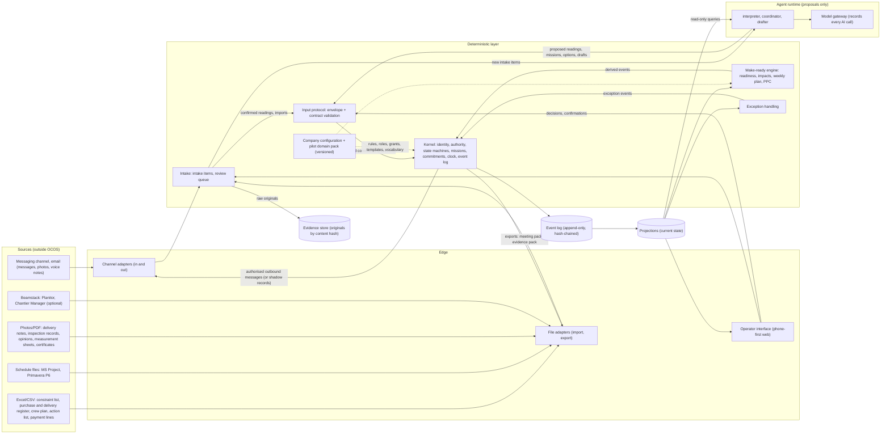

# OCOS v1.0.0 — Architecture

*Status: final v1.0.0 architecture for owner review, 2026-10-15 (round 2, corrected by the study: [STUDY.md](STUDY.md)). Scope: v1.0.0 only ([IDEA_v2.md](IDEA_v2.md) §16). The long-term direction appears only as extension points (section 16).*
*Companion documents: [IDEA_v2.md](IDEA_v2.md) (source of record for v1.0.0; the owner's original is [IDEA.md](IDEA.md)), [RESEARCH.md](RESEARCH.md) (evidence, `F-nn`), [REALITY_CHECK.md](REALITY_CHECK.md) (scenarios, `DC-n.m`), [core_logic.md](core_logic.md) (plain language), [v1.0.0_spec.md](v1.0.0_spec.md) (`SPEC-nnn`), [QUESTIONS.md](QUESTIONS.md) (`Q-nn`).*

**How to read the status of each statement**

- **IDEA_v2 §n** — taken from the refined idea (which keeps the owner's principles).
- **F-nn / DC-n.m** — grounded in a research finding or a scenario's design change.
- **PROPOSAL** — a design choice by the authors to make the idea buildable; the owner may change it.
- **TO-CONFIRM (Q-nn)** — waits for the owner; nothing that depends on it is treated as decided.

---

## 1. What v1.0.0 must do

A **make-ready assistant** for one general contractor's site team on one project and one work type (IDEA_v2 §16): read the messages and files the team already produces, keep the make-ready picture (requirements, commitments, readiness) current for the look-ahead, drive constraint resolution through missions and follow-up, prepare the weekly meeting, keep quantities and inspection releases distinct, and trace everything — in shadow mode first.

Pilot market: `TO-CONFIRM (Q-01)`; contractor and work type: `TO-CONFIRM (Q-02)`. The architecture does not depend on these answers except for the pilot domain pack (§4.9), the languages (§4.1) and hosting (§12).

## 2. Principles

| # | Principle | Source |
|---|---|---|
| P1 | One authoritative operational state, rebuilt from an append-only event log, replayable without an LLM. | IDEA_v2 §6 |
| P2 | AI interprets, investigates and proposes; deterministic code authorises, enforces constraints, changes state and records execution. | IDEA_v2 §6 |
| P3 | The kernel is small, stable, testable and independent of any AI model. | IDEA_v2 §6 |
| P4 | Reported fact, AI reading, verified observation and authorised decision are always distinguishable; a confirmed reading is attributed to the person who said it. | IDEA_v2 §5 |
| P5 | Unknown stays unknown; information is requested only when a decision or operation needs it. | IDEA_v2 §5 |
| P6 | Company behaviour comes from versioned configuration, never from forking the kernel; mandatory protections cannot be disabled by ordinary configuration. | IDEA_v2 §11 |
| P7 | The system never silently expands its own authority. | IDEA_v2 §10 |
| P8 | External systems and external parties stay authoritative for the records they own. | IDEA_v2 §12; F-18, F-20 |
| P9 | Shadow first, then confirm, then bounded autonomy one action type at a time. | IDEA_v2 §13, §16 |
| P10 | **Field first:** no new app for field people; input arrives through the channels they already use, and a person confirms the AI's reading. | IDEA_v2 §5, §14; F-14, F-36 |
| P11 | **Record, don't block:** OCOS records decisions made on site; its gates govern what it shows as ready and what it does itself. | IDEA_v2 §13; DC-2.4 |
| P12 | **Messages are not notices:** outbound messages never constitute contractual notices, instructions or acceptances. | IDEA_v2 §8; F-34 |

## 3. Components and data flows

**Boundary rules (PROPOSAL, from IDEA_v2 §6):**

- Everything that changes operational state enters through the **input protocol** and becomes an event written by the **kernel**. No other write path exists — not for adapters, the interface or agents.
- Raw inputs are stored as **originals** before anything else happens; nothing read from them changes state until a reading is confirmed (§4.1).
- Agents **read** projections and intake items and **submit** only proposals; they never write state and never call adapters. Outbound messages are executed by the kernel through channel adapters after authorisation, or recorded as shadow actions.
- The make-ready engine and exception handling are deterministic: same events and configuration version → same derived events; on replay they are recomputed and compared.

## 4. Components

### 4.1 Intake

**Job:** turn every incoming message, file and photo into an **intake item**, get it read, and get the reading confirmed (IDEA_v2 §5; DC-1.1, DC-2.2; F-09, F-39).

- **Intake item** = one received unit (a message with its attachments, a voice note, an uploaded file, an import batch). It records channel, sender (as known to the channel), conversation, time received, and the reference of the stored original. States: `received → interpreted → confirmed | corrected | discarded`, or `received → needs_reading` when the AI cannot or may not interpret it (unsupported language, unreadable file, AI off), after which a person reads it and records what it says.
- **Reading.** The *interpreter* agent proposes a structured reading: which entities (work package, requirement, commitment, location), which assertions (with value, unit and time), which commitments (promisor, what, due, firmness), which quantities, and **the quoted words** each item relies on, with a confidence. Voice notes are transcribed first; the transcript is kept as an evidence item.
- **Confirmation.** The operator sees a **review queue** on the phone: each reading with its quote and original, and three buttons: confirm, correct, discard. Confirmation produces events in which the **basis is `reported`, the actor is the original speaker** (or the channel's sender), the reading's provenance is the AI call, and the **confirmer is the operator** (P4). Corrections keep both the proposed and the corrected reading, which feeds metric M-08.
- **Second-hand reports.** The operator, or any configured company person dictating a voice note to the OCOS channel, can record "X reports that Y said …" (DC-2.2): actor X, source party Y.
- **Triage.** Chatter with no operational content is proposed as `no_content` and dismissed in one action, with a weekly sample checked; the queue is ordered by impact — next two weeks, hold points, missed commitments first (SPEC-137).
- **Location.** Each reading carries a location (zone, level, axis) taken from the text, chosen by the operator, or from photo metadata when present (DC-4.4).
- **Languages.** The languages the interpreter may read are configured; others go to `needs_reading`. Which languages: `TO-CONFIRM (Q-22)`.
- **Channel.** Which messaging channel is supported in v1.0.0, and how messages reach OCOS (a business number people write or forward to, or periodic chat-export import): `TO-CONFIRM (Q-03)`. Note F-32: task-specific business automation is allowed on WhatsApp's business platform, general-purpose assistants are not; the official Groups API only creates business-owned groups of at most 8 people, so **OCOS cannot join the existing site groups compliantly**. In practice the operator, who is already in those groups, forwards what matters, and chat exports fill the gaps. The channel adapter interface is the same for all options, and **email-in and manual upload always exist** as fallbacks.

### 4.2 Input protocol and event envelope

**Job:** every input — a confirmed reading, an imported row, a form, an agent's proposal, a timer — becomes a validated event with provenance.

- **Universal envelope** (SPEC-050): event id, type, contract version, time of occurrence and of recording, authenticated actor and actor kind, on whose behalf, source (channel, external system and record id, intake item, original reference), confirmer (if any), affected entities, correlation and causation ids, configuration version, payload, hashes.
- **Context-specific information contracts**, versioned per event type, so no one is forced to fill irrelevant fields (SPEC-013).
- **Schema language:** JSON Schema (PROPOSAL; language-neutral for independent adapters, IDEA_v2 §12).
- **Invalid input** is rejected as a whole with a reason and kept for review, never partially applied (SPEC-051).

### 4.3 Deterministic kernel

**Job:** keep the authoritative state and control every consequential transition (IDEA_v2 §6). Kept small:

| Kernel responsibility | v1.0.0 content |
|---|---|
| Identity, relationships | Stable ids; typed links: work package → requirement → commitment → mission → evidence; work package → location, payment line. |
| Ingestion, ordering, reconciliation | One ordered log per deployment; idempotency keys; conflicts handed to exception handling. |
| State machines | Those of SPEC-022, -029, -033, -041, -042, -080, -130, -038. Defined in code; configuration may add stricter guards, never remove kernel ones. |
| Identity, permissions, delegation | Section 7. |
| Requirements, invariants, gates | Kernel invariants (SPEC-106) plus configured gates; the fixed list of kernel gates: `TO-CONFIRM (Q-10)`. |
| Missions, commitments, deadlines, escalation | §4.5; deadlines fire through the kernel clock (§6.4). |
| Idempotent commands, failures | Every command has an idempotency key; failed executions recorded as `failed`. |
| Append-only history | Section 6. |
| Evidence and integrity | Evidence by content hash; hash-chained log (§6.5). |
| Configuration versions | Every event records the version in force. |

The kernel has **no dependency on any AI model or agent library** (P3) and works with the agent runtime stopped (SPEC-212): imports, manual readings, readiness, deadlines and decisions all still work.

### 4.4 Make-ready engine

**Job:** for each work package in the look-ahead, decide whether it is ready and why; run the weekly plan; compute what follows a disruption (IDEA_v2 §9; F-01, F-07, F-37).

- **Look-ahead.** Default 6 weeks, configurable from 3 to 6; the list of packages comes from the schedule file and is adjusted at the weekly meeting (SPEC-065, SPEC-073). The master schedule sets windows and milestones; the meeting decides what is in the look-ahead (V-09).
- **Readiness** is a pure function of requirement states: `ready`, `expected_ready`, `unknown`, `not_ready` (SPEC-060–SPEC-064). Hard requirements block; preferences never block; conditional requirements apply when their condition holds or is unknown. Tentative promises do not make a requirement `expected` (SPEC-062).
- **Weekly work plan.** At the weekly meeting the team commits to a set of packages for the week; the engine snapshots their readiness at commitment time, records each item as `done` or `not_done` with a reason category at week end, and computes PPC and tasks made ready (SPEC-074).
- **Impact analysis** is a deterministic graph walk over predecessor links, crew and equipment assignments in the window, and milestones (SPEC-069).
- **Recovery options** are proposed by the coordinator agent and filtered by the engine against hard dependencies, gates and authority before anyone sees them (SPEC-071).
- **Not in v1.0.0:** schedule optimisation and statistical forecasting. It explains; it does not optimise (PROPOSAL).

### 4.5 Missions, commitments and outbound messages

**Job:** turn constraints into traceable assignments, follow promises, and talk to people in their channel (IDEA_v2 §8).

- **Missions** follow `proposed → issued → acknowledged → in_progress ⇄ blocked → reported_done → verified`, exits `declined`, `cancelled` (SPEC-080). Five accountability roles stay separate fields (SPEC-082).
- **Commitments** are promises made by people (often from the weekly action list, SPEC-075, or a message): `requested → promised | declined`, `promised → reported_fulfilled → fulfilled`, `promised → missed | withdrawn`, with a **firmness** `firm` or `tentative` and a due date with optional time (SPEC-032, SPEC-033).
- **Follow-up and escalation** are deterministic: acknowledgment windows, deadlines and escalation paths come from configuration and fire through the kernel clock (SPEC-081).
- **Outbound messages** (mission notices, reminders, information requests, escalations) are drafted by the *drafter* agent from approved templates, sent through the channel adapter **in the name of a named company person**, carry the fixed "not a contractual notice, instruction or acceptance" statement, go only to configured recipients, and respect each recipient's "do not message" flag (SPEC-089). Each message type has an action mode (§9). Replies come back as intake items.

### 4.6 Inspections, releases and quantities

**Job:** model hold points, witness points, external verifiers and the quantities used for payment without taking anyone's legal role (IDEA_v2 §9; F-17–F-25; DC-3.x, DC-4.x).

- An inspection requirement has `gate_kind` `hold_point` or `witness_point` (SPEC-028). A witness point needs the notification recorded; it never blocks readiness. A hold point blocks until released.
- **Release in two steps** (SPEC-042): `release_reported` — a named contractor person records that a named external verifier released it (verbally or by message); it satisfies the hold point only where the configuration allows reported releases for that inspection type — and `release_evidenced` — the signed record is attached and verified. A reported release without evidence after the configured delay opens an exception.
- **External parties** (maître d'œuvre, engineer, bureau de contrôle, inspectors) are registered as named external parties. When they decide, the contractor's operator records the decision; the trace names the external party as decision authority and the operator as recorder (SPEC-037).
- **Opinions** from a bureau de contrôle (`favourable`, `unfavourable`, `suspended`) are external assertions with their document; unfavourable or suspended opens an exception; they are gates only if configured (SPEC-043).
- **Quantities** of kind `reported`, `measured`, `agreed` (signed by both sides, or deemed accepted after the contractual objection period — 15 days in the Moroccan CCAG-T, F-23 — which the kernel clock can track as a deadline), `certified` are separate records with sources; `certified` is recorded only from the certifier's document and never computed (SPEC-023, SPEC-024). Work packages can link to payment lines imported from Excel. How far v1.0.0 goes: `TO-CONFIRM (Q-17)`.
- **Evidence pack** export per work package and period (SPEC-192).

### 4.7 Exception handling

**Job:** register every situation the rules do not cover and drive it to a decision (IDEA_v2 §10).

- **Detection** is deterministic: missing information blocking a decision, conflicting assertions, missed commitment, unmet hard requirement in the window, rejected input, failed action, unavailable source, reported release without evidence, unfavourable opinion, deviation between written rule and observed practice, no applicable rule (SPEC-160).
- **Investigation** is where agents help: gather related facts, separate known / uncertain / assumed / missing, draft responses.
- **Resolution** needs a human decision or a pre-authorised action, and a verified outcome (SPEC-164).
- **Learning** (later, not in v1.0.0): recurring exceptions produce draft configuration changes, never applied automatically (SPEC-165).

### 4.8 Agent runtime

**Job:** run AI agents as bounded, declared operators that read and propose (IDEA_v2 §7).

- **Three roles in v1.0.0** (SPEC-163; F-30, F-39): **interpreter** (intake readings, spreadsheet mappings, configuration drafts from company tables), **coordinator** (per work package: missions, information requests, recovery options), **drafter** (weekly meeting pack, draft action lists, outbound message texts). People are stewards.
- **Role declaration** — each role is a configuration file declaring scope, responsibilities, triggers, tools, permissions, output contract, completion conditions, delegation, failure policy, escalation; the runtime refuses an incomplete one.
- **Tools** are only read-only queries and submissions through the input protocol.
- **Model gateway** — every model call records model id and version, prompt-template version, input references and output (SPEC-183). Provider and data policy: `TO-CONFIRM (Q-21)`.
- **No heavy agent framework**: a thin in-house loop over the provider's API keeps the agent layer replaceable (PROPOSAL).
- **Failure:** if the model is unavailable or an output fails its contract, intake items go to `needs_reading` and the deterministic layer continues.

### 4.9 Company configuration, pilot domain pack and narrow compiler

**Job:** adapt OCOS to the pilot company without changing the kernel (IDEA_v2 §11).

- **Company configuration** (versioned, tested, deployed independently of code): vocabulary mapped to OCOS primitives (SPEC-112), roles and the authority matrix, recipients and "do not message" flags, mission and message templates, escalation paths, evidence rules per claim type, which inspection types allow reported releases, the planning rhythm (meeting day, look-ahead length), integration mappings.
- **Pilot domain pack:** requirement templates for the pilot work type — for a slab pour: formwork complete, rebar delivered and fixed, sleeves and embeds placed, pre-pour inspection (hold point), concrete ordered, pump booked, crew assigned, access clear, weather acceptable (DC-1.3), and, where the contract requires it, the contradictory record of the reinforcement quantities before they are hidden (F-23). Content depends on `TO-CONFIRM (Q-02)`.
- **Narrow compiler** (DC-5.1) — **later, not in v1.0.0** (study: for one pilot the configuration is written by hand with the contractor): the interpreter drafts templates, roles, grants and vocabulary from the company's Excel checklists, approval matrices and templates; every drafted item is accepted, edited or rejected by a person; a named company approver signs a version after reading plain-language scenario tests (SPEC-108, SPEC-110). Whether v1.0.0 includes it: `TO-CONFIRM (Q-18)`.
- **Written rule vs practice:** observed deviations become `deviation` exceptions (SPEC-111).
- **What configuration may and may not change:** `TO-CONFIRM (Q-10)`. The planning method stance: `TO-CONFIRM (Q-05)`.

### 4.10 File adapters

**Job:** import and export files while preserving source authority and provenance (IDEA_v2 §12; F-11, F-29).

- **Imports:** Excel/CSV (constraint list, purchase and delivery register, crew and equipment plan, weekly action list, payment lines) through **confirmed mappings** (SPEC-129); schedule files from MS Project (MPP, MSPDI XML) and Primavera P6 (XER, P6 XML) through the open-source MPXJ library (S-50) isolated in its own adapter (SPEC-120).
- Every imported value becomes a `reported` assertion naming the source system or file, the record id or row, the extraction time and the mapping version (SPEC-123). Re-imports produce differences, never silent overwrites (SPEC-124). Staleness and unavailability are shown (SPEC-125, SPEC-128).
- **Exports:** weekly meeting pack (PDF, Excel), evidence pack (PDF plus integrity file), trace export.
- **Write-back** into external systems: `TO-CONFIRM (Q-15)`; recommendation none in v1.0.0.
- **Adapter contract:** adapters are independent programs that use only the published input protocol and query interface (PROPOSAL).

### 4.11 Operator interface

**Job:** let the operator and managers confirm, decide and see (IDEA_v2 §14). Phone-first responsive web application (PROPOSAL):

- **review queue** — readings to confirm, correct or discard, with quote and original;
- **readiness board** — by default the next two weeks plus anything `not_ready` further out, state and reasons; full look-ahead one tap away; filled at go-live by a seeding session (SPEC-077);
- **work-package page** — requirements, commitments, missions, evidence, quantities, trace;
- **approval queue** — proposals waiting for a decision, with consequences and the authority needed;
- **weekly plan** — commit packages for the week, mark done / not done with reasons;
- **exception queue**;
- **shadow review** — what OCOS would have done, for labelling;
- **configuration review** — drafted configuration items to accept, edit or reject.

Interface language: `TO-CONFIRM (Q-22)`.

## 5. A worked data flow: the late rebar delivery

1. The purchase register import creates a commitment `promised`, firmness `firm`, AcierSud, due Monday (no time), linked to requirement "rebar on site" of *Slab L3-B*; the slab is `expected_ready`.
2. Monday 10:02 Youssef posts "lhdid ma jach" + photo in the channel → intake item `received`; original stored.
3. The interpreter proposes: subject *Slab L3-B* / requirement "rebar on site"; assertion "not delivered" (quote: "lhdid ma jach"); related commitment AcierSud, due Monday; confidence 0.8. Intake item `interpreted`.
4. Karim, operator, confirms in the review queue at 10:20 → assertion basis `reported`, actor Youssef, confirmer Karim, provenance = the AI call.
5. The commitment is still `promised` (due end of Monday), so the requirement stays `expected` and the slab `expected_ready`; its explanation now shows Youssef's confirmed report (SPEC-067). The coordinator proposes an information request to Hicham ("get a confirmed new delivery time from AcierSud by 14:00"). In shadow mode this is a `shadow_action`; in confirm mode it waits in Karim's approval queue.
6. Monday at the configured end of working day: `deadline.reached` → commitment `missed` → requirement `unmet` → slab `not_ready` → `readiness.changed` and `impact.assessed` (rebar crew idle Tuesday, concrete order and pump Thursday at risk, walls L4-B delayed). An exception of type `blocker` is routed to Karim.
7. The coordinator proposes two recovery options; the engine filters them; Karim chooses one → `decision` (`choose`) with rationale. Karim may add a cost note ("pump cancellation fee if cancelled after Wednesday 12:00", DC-1.5).
8. Tuesday 07:40 Hicham writes "AcierSud: livraison mardi 14h" → new tentative commitment after confirmation; at 14:30 the delivery note photo arrives → evidence; Karim verifies it from the review queue → requirement `met` → readiness recomputed.
9. The trace view shows every step, including the readings, who confirmed them, the missed promise, the options not chosen and who decided.

## 6. Kernel state model and event log

### 6.1 Event sourcing

The state of OCOS is **the result of applying its event log in order** (PROPOSAL; the most direct way to satisfy IDEA_v2 §6). One append-only log per deployment; current state is held in **projections** that can be dropped and rebuilt.

*Implementation note (from the review, REALITY_CHECK §7, objection C-1):* this is deliberately the plain version of the pattern — one PostgreSQL table of events, projections updated **in the same database transaction** as the append, no message bus, no separate event-store product, no distributed processing. The hash chain is two columns. Derived events are compared with recomputed ones in the nightly replay test, not on every write.

### 6.2 Commands and events

- A **command** asks for a change; the kernel checks contract, authority, state machine, invariants and idempotency, then appends events or a `command.rejected` event (SPEC-109).
- An **event** is immutable (SPEC-180).
- **Derived events** (readiness, impacts, PPC, exceptions detected by rules) are appended so the trace shows them; on replay they are recomputed and compared.

### 6.3 Replay without an LLM

AI outputs are stored as data inside the events that carry them (the proposed reading, the proposal text, the model provenance). Replay never calls a model, an adapter or the network (SPEC-184).

### 6.4 Deterministic time

Rules never read the system clock. The kernel clock appends `deadline.reached` events; rules react to them. When a due date has no time, the deadline is the configured end of working day in the project's time zone (SPEC-033). PROPOSAL.

### 6.5 Corrections and integrity

- Corrections are `correction` events referencing the original, both visible.
- Each event stores the hash of its content and of the previous event; a verification tool reports the first altered or missing event (SPEC-185). Signed checkpoints outside the deployment: later, not in v1.0.0 (`TO-CONFIRM (Q-14)`).
- Evidence files are stored by content hash (SPEC-036).
- Integrity proves records were not changed after recording; it never proves they were true (SPEC-187).

### 6.6 Configuration versions in the log

Configuration changes are events; every event records the configuration version in force (SPEC-108).

## 7. Authority and permission model

### 7.1 Actors and parties

Every event has an authenticated **actor** of kind **person**, **agent** or **integration** (SPEC-189). **External parties** (subcontractors, suppliers, maître d'œuvre, bureau de contrôle) are recorded as named parties and may be the *source* of a reported fact or the *decision authority* of a recorded external decision, without being OCOS users.

### 7.2 Grants

Authority is expressed as **grants**: actor or role, action type, scope, limits, validity period, delegated from. The kernel checks a grant for every command (SPEC-100); no grant means no (SPEC-104).

### 7.3 Delegation

Delegation events are later, not in v1.0.0 (SPEC-102): in v1.0.0 grants come only from the approved configuration. Agents receive grants only through approved configuration; no agent can create or widen a grant (SPEC-101).

### 7.4 Gates

- **Human-authorisation actions** (physical execution, safety-critical decisions, contractual commitments, purchases beyond limits, financial approvals, quality acceptance, consequential resource changes) are never available to agents (SPEC-103). When such a decision is taken on site, it is recorded afterwards as a reported decision (SPEC-039).
- **Inspection gates**: hold and witness points (§4.6). The list of gates fixed in the kernel and whether anyone may waive one: `TO-CONFIRM (Q-10)`.
- **Configuration governance**: tests pass, a named approver signs (SPEC-108).
- **Autonomy gate**: each action type has a mode `shadow`, `confirm` or `bounded_auto` (§9). No action type reaches `bounded_auto` in v1.0.0; which may later: `TO-CONFIRM (Q-11)`.

### 7.5 Separation of roles

The five accountability roles are separate fields; the executor of a mission cannot verify it unless the template allows it (SPEC-083).

## 8. How AI is confined

| AI may | Deterministic code decides |
|---|---|
| propose readings of messages, voice transcripts, files, spreadsheets, procedures | whether a reading is confirmed (by a person) and recorded |
| investigate exceptions; summarise known / uncertain / missing | which requirement state follows from which assertions |
| propose missions, recovery options, information requests, message texts, meeting packs | readiness, deadlines, escalations, missed commitments, PPC |
| draft configuration items and rule changes | whether the actor holds the authority |
| choose among capabilities its role declares | whether a gate is satisfied and a transition allowed; what is sent and recorded |

Hard rules (PROPOSAL, from P2, P4):

- An AI reading changes nothing until a person confirms it (SPEC-134); an `inferred` assertion alone never makes a hard requirement `met` (SPEC-061).
- An AI agent is never the decision authority, recorder of an external decision, or verifier (SPEC-103).
- Every AI output carries provenance (SPEC-183) and an "AI suggestion" label.
- AI never states causation or blame (SPEC-188).
- The deterministic layer works with AI off (SPEC-212).

## 9. Shadow mode

- **Modes per action type** (SPEC-140): `shadow` (computed and recorded, not executed, visible only to the review audience), `confirm` (executed after explicit approval), `bounded_auto` (executed within the grant's limits). Action types in v1.0.0: `intake.confirm_reading`, `mission.issue_internal`, `mission.issue_external`, `message.reminder_internal`, `message.reminder_external`, `message.information_request`, `escalation.notify`, `pack.publish_weekly`. All start in `shadow`. `intake.confirm_reading` is the *automatic* confirmation of readings; manual confirmation by the operator is not an action type and is always available — the operator's confirmations *are* the shadow-period labels for readings (SPEC-140).
- **Shadow needs passive intake** (V-16): OCOS can only be evaluated in shadow if messages flow in without OCOS sending anything. The channel answer (`Q-03`) must allow that, or the shadow period runs on periodic chat exports.
- **Review:** reviewers label shadow actions `correct`, `incorrect` or `unnecessary` and record constraints OCOS missed (SPEC-143).
- **Who sees shadow output during the baseline:** `TO-CONFIRM (Q-07)`.
- **Leaving shadow** is a recorded decision by a configured authority, reversible instantly (SPEC-144); criteria: `TO-CONFIRM (Q-12)`.

## 10. Integration with external systems, platforms and the Beamstack

- **Source authority** (P8): the schedule file owns the schedule; the purchase register owns orders; the certifier's document owns certified quantities; the bureau de contrôle's report owns its opinion. OCOS stores its own observations alongside; disagreement raises a `conflict` exception (SPEC-126, SPEC-027).
- **What OCOS owns** in v1.0.0 (PROPOSAL, pending `TO-CONFIRM (Q-15)`): intake items and readings, missions, commitments recorded through OCOS, requirement states, readiness, weekly plans and PPC, exceptions, decisions and the trace.
- **Project platforms** (Procore, Autodesk, Aconex): not in v1.0.0 unless the pilot already depends on one: `TO-CONFIRM (Q-08)`.
- **Beamstack** (IDEA_v2 §12): Planitor and Chantier Manager adapters use the same adapter contract as any third party: `TO-CONFIRM (Q-16)`.
- **Standards** (IFC, BCF, IDS, COBie): extension points only (F-29).

## 11. Technology choices

| Choice | Status | Recommendation | Reason |
|---|---|---|---|
| Language and database | `TO-CONFIRM (Q-23)` | Python (typed) back end; TypeScript web interface; PostgreSQL for the event table and projections | Best libraries for spreadsheets, documents and AI providers; one proven open-source database, easy to self-host. Schedule files need MPXJ (Java, S-50) — run it in its own adapter process. |
| Evidence storage | PROPOSAL | S3-compatible object store, files by content hash | Works on every hosting model; protected evidence references. |
| Schema language | PROPOSAL | JSON Schema | Language-neutral typed contracts. |
| Speech-to-text | PROPOSAL (follows Q-21, Q-22) | Through the model gateway, same data policy as other AI calls | Voice notes are a main field input (F-09, S-18). |
| Agent framework | PROPOSAL | None; thin in-house loop | Kernel independent of AI tooling. |
| Model provider and data policy | `TO-CONFIRM (Q-21)` | One commercial provider under no-training, limited-retention terms, behind the gateway; open-weight fallback tested | Interpretation quality matters most (F-39); data transfer rules (F-35) may impose a region or self-hosting. |
| Hosting and data residency | `TO-CONFIRM (Q-20)` | Single-tenant per company, operated by the OCOS team for the pilot, in a region acceptable under the pilot's data law; customer-hostable | F-35. |
| Packaging | PROPOSAL | Container images, one compose file | Same artefact for any hosting answer. |
| Identity and login | PROPOSAL | OpenID Connect, or one-time links by phone for the operator | Authenticated actors without passwords. |
| License and governance | `TO-CONFIRM (Q-19)` | Apache-2.0; owner-led maintainership with a public proposal process | Adoption, patent grant. |
| Business model | `TO-CONFIRM (Q-09)` | Open core free; paid hosting, onboarding and support | Affects what is in the open repository. |

## 12. Deployment shape (v1.0.0)

PROPOSAL, for the recommended answer to Q-20. One deployment per company:

- **kernel service** — input protocol, intake, kernel, make-ready engine, exception handling, query API, clock;
- **agent worker** — agent runtime and model gateway; can be stopped without stopping the kernel;
- **adapter workers** — channel adapter, file adapters (the schedule-file adapter in its own process);
- **web interface**;
- **PostgreSQL** and an **object store**;
- **backups** with a periodic restore-and-replay test.

Pilot volumes (one project: thousands of work packages, tens of thousands of events, a few hundred messages a day) fit one server.

## 13. Data storage

| Data | Where | Rule |
|---|---|---|
| Events | PostgreSQL, append-only table | Insert-only role; update/delete blocked; hash-chained. |
| Projections | PostgreSQL tables | Disposable; rebuilt from events. |
| Originals, evidence, transcripts | Object store | By content hash; never overwritten. |
| Configuration versions | Event log + versioned files per company | Every event names the version. |
| AI call records | In the events they produced | Model, prompt version, input references, output. |
| Full export | Event log, originals, evidence, configuration versions, verification tool | Documented open format; the company keeps its data if OCOS stops (SPEC-214). |
| Personal data | Separate personal-data store referenced from events (names, phone numbers, message authors) | Lets personal details be removed or pseudonymised under data-protection law without breaking the hash chain (PROPOSAL); retention and visibility: `TO-CONFIRM (Q-13)`. |

## 14. Security and data protection

- Every actor authenticated; agents and integrations have their own identities and narrow grants.
- Least privilege; no grant, no action.
- Encryption in transit and at rest.
- The model gateway sends only what the role declares it needs; which data may leave the deployment and to whom: `TO-CONFIRM (Q-21)` (F-35: a transfer abroad from Morocco may need CNDP authorisation; GDPR applies in the EU).
- Prompt-injection containment: message and document text is data; agents can only submit proposals the kernel checks.
- Outbound messages only to configured recipients; no address taken from AI output; "do not message" respected (SPEC-089).
- No individual performance views in v1.0.0 (PROPOSAL, pending `TO-CONFIRM (Q-13)`): OCOS reports by organisation and role, not by worker; no geolocation tracking of people.
- Security events are part of the log.

## 15. Testing strategy

| Layer | How it is tested |
|---|---|
| Kernel state machines and invariants | Unit tests for every allowed and forbidden transition; property-based tests. |
| Replay | Golden logs replayed with network and models off; projection hashes match (SPEC-184). |
| Integrity | Tamper tests (SPEC-185). |
| Make-ready engine | Table-driven readiness tests; impact graph tests; PPC computation tests. |
| Authority | For every gate: right grant passes, others refused and recorded. |
| Company configuration | Plain-language scenario tests per version (SPEC-108). |
| File adapters | Contract tests on sample files from the pilot; idempotent re-import. |
| Interpreter | Offline evaluation set built from the pilot's own (anonymised) message history before go-live: reading accuracy per language and per category, quote faithfulness, output-contract compliance; re-run on every prompt or model change. |
| End to end | The five REALITY_CHECK scenarios, scripted, in shadow and confirm modes. |
| In the field | Operator confirmations and shadow labels (§9) — the test that matters most. |

## 16. Extension points (after v1.0.0)

- **Domain packs** for more work types and trades.
- **Narrow compiler** (SPEC-110), then the **full Company Operations Compiler** from documents of any kind.
- **Delegation events** (SPEC-102), **missions to agents** and **sub-missions** (SPEC-084, SPEC-085), **written-rule deviations** and **rule-improvement drafts** (SPEC-111, SPEC-165), **external integrity anchoring** (SPEC-186) — moved here by the study.
- **More adapters**: IFC, BCF, IDS, COBie, ERP, Procore/Autodesk/Aconex, sensors — same adapter contract.
- **Full agent hierarchy**: global and domain stewards as agents.
- **Auto-confirmation** of high-confidence readings per category, as accuracy evidence accumulates.
- **Write-back** to external systems under explicit agreements.
- **Multi-company coordination**: subcontractors, suppliers and owners sharing parts of the state.
- **Capability exchange**: governed third-party contributions.
- **Wider bounded autonomy**, action type by action type.

## 17. Build order (v1.0.0)

PROPOSAL, from the review (REALITY_CHECK §7, C-2 to C-4), **rewritten by the study** so that every v1.0.0 requirement sits in exactly one slice and the loops can cut each slice into tasks that each reach green CI in one turn ([STUDY.md](STUDY.md)). Every slice runs on the pilot in shadow mode.

**Two trials, run beside slice 1, not before it.** Slice 1 needs no channel and no AI, so it does not wait for them; each trial gates the slice-2 tasks that depend on it. Both need the owner or the pilot, not a loop.

| Trial | What it proves | Needs first | Gates |
|---|---|---|---|
| T1 channel | the chosen route (`Q-03`) works within the platform's terms on a test number, passive intake works for shadow, and the pilot's chat export shows what share of site facts really arrive by message (M-12 baseline, F-09) | Q-03; a business account verified by Meta (owner) | the channel-adapter tasks |
| T2 interpreter | SPEC-138 on the pilot's exported history, per language | Q-01, Q-02, consent and provider (Q-13, Q-21); the evaluation harness (a slice-2 task, built on synthetic data) | turning the interpreter on with real data |

| Slice | Content | Requirements | Exit check |
|---|---|---|---|
| 1 — see (no AI, no outbound) | event log and envelope, grants, entities, assertions, requirements, commitments, decisions, exceptions; file imports with confirmed mappings; intake by email and upload with manual reading; readiness, explanation, board and seeding; trace, replay, tamper check | SPEC-001, -003, -004, -005, -010–013, -020–022, -025–030, -032, -033, -036, -037, -039–041, -050–052, -060–068, -073, -077, -100, -101, -103, -104, -106, -108, -109, -112, -120, -121, -123–126, -128–130, -134, -135, -160–162, -164, -180, -182, -184, -185, -187, -189, -212 | the pilot's board matches the site manager's own view on a weekly check |
| 2 — read and follow | interpreter, voice notes, review queue and triage, inbound channel; agent runtime and model gateway; missions and follow-up; action-list import, weekly plan, PPC, meeting pack; impact analysis; shadow mode and labelling; personal-data store; metrics | SPEC-002, -006, -034, -035, -038, -069, -072, -074–076, -080–083, -086 (inbound), -087, -088, -122, -127, -131–133, -136–138, -140–146, -163, -166, -181, -183, -188, -190, -200–205, -210, -211, -213 | meeting pack used in two consecutive weekly meetings |
| 3 — act and prove | outbound messages in confirm mode; recovery options; hold and witness releases, opinions, kernel gates; quantity kinds and evidence packs; full export | SPEC-023, -024, -031, -042, -043, -070, -071, -086 (outbound), -089, -107, -192, -214 | first action type proposed for leaving shadow under `Q-12` criteria |

The 9 later requirements (spec §14) are in no slice. Slices 1 and 2 send nothing, which keeps the riskiest external dependency (F-32) out of the critical path. A slice is a milestone, not a task: the backlog cuts it into tasks of one requirement group each (for example "SPEC-060–064 readiness function with its table tests"), each naming the requirements it implements.
